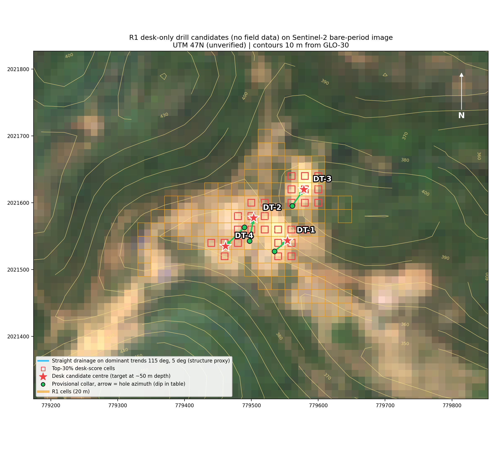
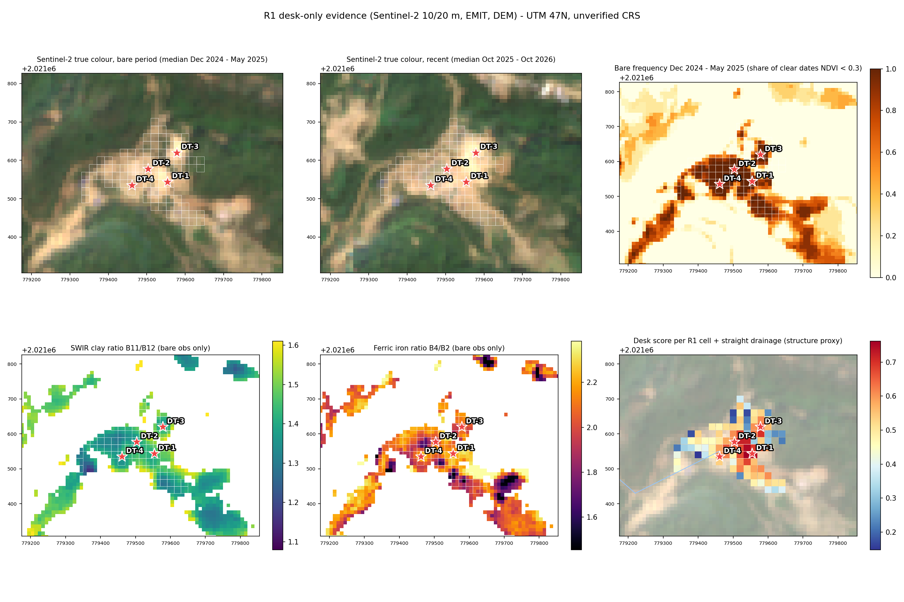

# R1 Desk-Only Drill Candidates and Imagery Options

**Site:** Site 02, Sangthong, Laos. R1 / R01 patch, 3.92 ha, UTM 47N (EPSG:32647, still to be verified by GNSS)
**Date:** 12 Oct 2026
**Basis:** data already on hand plus free data pulled for this report. No field sampling.
**Files:** `outputs/r1_desk/` (targets and collars as GPX/KML/CSV, maps, per-cell evidence)
**Reproduce:** `fetch_s2_r1.py`, then `r1_desk_targeting.py` (run both with `~/miniconda3/envs/geo/bin/python`)

---

## 1. Answer: four desk candidates inside R1

These are ranked targets for **scout holes**, chosen only from remote data:
- spectral evidence from 2024–25, when R1 was bare
- terrain
- a structural guess from drainage directions

None of them is confirmed mineralisation (§5 explains why). If the team drills before any sampling, drill in this order.

| Rank | ID | Target centre E / N (lat, lon) | Elev / ground slope | Score (0–1) | Stable under alternative weightings | Nearest old point |
|---|---|---|---|---|---|---|
| **1** | **DT-1** | 779,554 / 2,021,544 (18.265149, 101.643943) | 385 m / 31° | **0.69** | **5 of 5** | C07 44 m, C02 48 m |
| **2** | **DT-2** | 779,503 / 2,021,577 (18.265460, 101.643470) | 367 m / 16° | **0.65** | **5 of 5** | C07 33 m, C10 39 m |
| 3 | DT-3 | 779,578 / 2,021,620 (18.265835, 101.644186) | 404 m / 14° | 0.56 | 3 of 5 | C04 11 m |
| 4 | DT-4 | 779,461 / 2,021,535 (18.265086, 101.643068) | 361 m / 2° | 0.56 | 3 of 5 | C06 40 m, C10 41 m |

**Provisional holes.** Each hole aims at a point about 50 m below its target centre:

| ID | Collar E / N (lat, lon) | Collar elev / slope | Azimuth / dip | Length to target / planned depth | Angle across the assumed WNW structure |
|---|---|---|---|---|---|
| DT-1 | 779,535 / 2,021,528 (18.265006, 101.643759) | 364 m / 9° | 050° / −49° | 38 m / **80 m** | 37° |
| DT-2 | 779,497 / 2,021,543 (18.265150, 101.643408) | 363 m / 11° | 010° / −52° | 57 m / **100 m** | 36° |
| DT-3 | 779,561 / 2,021,595 (18.265616, 101.644020) | 395 m / **20°** (pad must be levelled) | 035° / −54° | 51 m / **100 m** | 35° |
| DT-4 | 779,490 / 2,021,564 (18.265337, 101.643339) | 363 m / 11° | 225° / −52° | 66 m / **110 m** | 35° |

**Suggested drill order:**
1. **DT-1** first. It has the strongest and most stable evidence and the shortest hole.
2. **DT-2 and DT-4 from one pad.** Their collars are about 23 m apart on the same flat bench (11°), so both holes can be fanned from a single pad, one at 010° and one at 225°.
3. **DT-3** only if the first holes show alteration or veining. Its pad needs levelling and its evidence is weaker.

**Total metres:** 290 m for DT-1, DT-2 and DT-4; 390 m if DT-3 is added.

**Azimuths are provisional.** They assume a steep structure running about 117° (WNW–ESE), which is the dominant drainage direction around R1 (§4). If anyone measures a vein or fault at a collar during pad preparation, re-run [r1_collar_calc.py](r1_collar_calc.py) with the measured strike and dip.

---

## 2. Maps

**How to read the map:**
- **Background:** Sentinel-2 true colour, median of the bare period Dec 2024 – May 2025, with 10 m contours.
- **Orange squares:** R1's 20 m cells.
- **Red squares:** the top 30% of cells by desk score.
- **Stars:** target centres.
- **Green dots and arrows:** provisional collars and hole directions.

**Panels:**
- **Top row:**
  - true colour in the bare period
  - true colour in the recent period (Oct 2025 – Oct 2026)
  - how often each pixel was bare in Dec 2024 – May 2025
- **Bottom row:**
  - SWIR clay ratio, B11/B12
  - iron-oxide ratio, B4/B2
  - desk score per R1 cell

Both ratios are computed only on bare observations.

**What the recent image shows:** linear tracks now run through and next to R1, and the bare ground extends in long arms to the SW and SE. That is consistent with earthworks or clearing.

---

## 3. Why each candidate

Percentiles compare R1 with **about 1,085 other bare Sentinel-2 pixels within 1.5 km**. 50 = typical bare ground, 90 = among the top 10%. The EMIT columns count, out of 4 dates, how often EMIT detected the mineral at that spot.

| Evidence | DT-1 | DT-2 | DT-3 | DT-4 | What it means |
|---|---|---|---|---|---|
| S2 iron-oxide ratio, B4/B2 (percentile) | **82** | 65 | 62 | 68 | Ferric iron staining |
| S2 0.9 µm Fe³⁺ absorption (percentile) | 79 | **95** | 54 | **96** | Goethite/hematite absorption depth |
| S2 SWIR clay ratio, B11/B12 (percentile) | 63 | 55 | **65** | 39 | 2.2 µm OH absorption; dry vegetation can also raise it |
| Bare frequency, Dec 2024 – May 2025 | 0.78 | **0.97** | 0.67 | **1.00** | How often the spot was really exposed, i.e. how reliable the spectra are |
| EMIT Fe-oxide / kaolin (of 4 dates) | **3.9 / 3.9** | 3.6 / **4.0** | 1.3 / **4.0** | 3.3 / 3.5 | Repeatability across EMIT dates (60 m pixels) |
| Height above nearest drainage | 23 m | 9 m | **31 m** | **1.8 m** | Higher = more likely in-place weathered rock, lower = more likely slope wash |
| Distance to a straight drainage on the WNW trend | 331 m | 339 m | 411 m | 282 m | No such drainage crosses R1 (§4) |

**DT-1: east-central spur flank, rank 1**
- **For:**
  - It has the strongest combined iron signal in R1: B4/B2 at the 82nd percentile and Fe³⁺ depth at the 79th.
  - EMIT detected Fe-oxide and kaolin on almost every date.
  - It is 23 m above the drainage, so the iron is more likely to be in place than washed in.
  - It stays a top pick under all five alternative weightings.
- **Against:**
  - The target itself is on a 31° slope. The collar has to sit 25 m SW, on 9° ground.
  - The hole is short, at 80 m.

**DT-2: central spur, rank 2**
- **For:**
  - It was bare in 97% of clear dry-season images, so its spectra are the most reliable in R1.
  - It has very strong Fe³⁺ absorption (95th percentile).
  - EMIT detected kaolin on 4 of 4 dates.
  - It was top-ranked under every weighting.
- **Against:**
  - Its clay ratio is only average.
  - It is 9 m above the drainage, so slope wash can't be ruled out.

**DT-3: summit, NE corner, rank 3**
- **For:**
  - It is the highest point in R1, 31 m above the drainage, and the least likely to be transported cover.
  - It has the highest clay ratio of the four, and EMIT detected kaolin on 4 of 4 dates.
- **Against:**
  - Iron evidence is weak (EMIT Fe on only 1.3 of 4 dates; Fe³⁺ depth at the 54th percentile).
  - It was bare less often (67%).
  - The collar pad is on 20° ground.
- **Note:** old point C03 ("dickite") was nearby. That dickite came from a single EMIT pixel on a single date and does **not** support this target.

**DT-4: western hollow, rank 4**
- **For:**
  - It was bare on every clear date.
  - It has the strongest Fe³⁺ absorption in R1 (96th percentile).
  - Its ground is the flattest (2°).
- **Against:**
  - It sits only 1.8 m above the drainage. Iron here could be slope wash or a ferruginous seep collected from upslope.
  - Its clay ratio is the lowest of the four.
- **Possible upside:** a linear hollow can also mark a fault, which is why the hole drills under it from the DT-2/DT-4 pad.

**Why not elsewhere in R1** (zone means from `r1_cells_evidence.csv`):
- **Southern lobe (18 cells):** it was well exposed (bare 0.75 of dates). But its iron-oxide ratio is only average (50th percentile), and it sits low, 6.7 m above the drainage, so it is likely to collect wash from the spur above it.
- **Western margin (13 cells):** it has the weakest clay (33rd percentile) and Fe³⁺ (45th) signals in R1, and it is also low (4.7 m above the drainage).
- **Northern tip (15 cells):** it was often covered (bare 0.38) and its Fe³⁺ signal is weak (33rd percentile). Its clay ratio is high (75th), but low exposure makes that reading less reliable; DT-3 takes the best of this area.

---

## 4. How the candidates were ranked

| Layer | Data | Weight | Notes |
|---|---|---|---|
| Spectral (Sentinel-2) | 28 scenes from Dec 2024 – May 2025, 10/20 m. Median of bare observations (NDVI < 0.3, SCL vegetation/soil class) for B4/B2, the 0.9 µm Fe³⁺ depth (B8A against a B5–B11 continuum) and B11/B12. Each is ranked against bare ground within 1.5 km. | 0.35 | Sharper than EMIT's 60 m pixels. Broad bands, so no mineral identification. |
| EMIT persistence | L2B mineral maps, 4 dates (2025-01-22, 2026-01-21, 2026-01-25, 2026-04-16) | 0.15 | 60 m pixels, shared by neighbouring cells |
| Exposure | Sentinel-2 bare frequency in the bare period | 0.20 | Reliability of the spectral layer |
| In-situ position | Height above nearest drainage (30 m GLO-30 DEM) | 0.20 | Penalises hollows where material collects |
| Structure | Distance to straight drainage segments on the dominant trend | 0.10 | Low weight, because no trend-parallel valley crosses R1 |

**Selection and sensitivity:**
- **Smoothing:** scores are averaged over a 30 m neighbourhood, since a drill target is larger than one 20 m cell.
- **Peak picking:** the four highest peaks were taken, at least 70 m apart.
- **Sensitivity test:** candidates were re-picked under five other weightings: equal, spectral-only, no EMIT, in-situ-heavy and EMIT-heavy. DT-1 and DT-2 come back every time; DT-3 and DT-4 in 3 of 5.

**Structure proxy:** I took 69 straight drainage segments from the Site 02 DEM; full results are in `outputs/r1_desk/dem_straight_drainage_segments.csv` and `dem_drainage_rose.png`.
- **Dominant family:** 90–150°, peaking at 110–120° (WNW–ESE), with 37 trend-parallel segments.
- **Minor family:** 0–10°, which is weak.
- **None crosses R1;** the nearest is 130 m from an R1 cell. The 117° strike is the best available guess, not a mapped structure.

**Provisional hole design:**
- **Collar search:** every point 15–110 m from each target was tested.
- **Hole shape:** each hole aims at a point 50 m below the target, with dip between −45° and −65°.
- **Ranking order:**
  1. crosses the assumed 117° structure at ≥ 35°
  2. collar slope ≤ 15°
  3. shortest hole

  For a steep structure, a −45° to −65° hole can't cross it at more than about 45°.
- **Planned depth:** length to target plus about 40 m.

---

## 5. Confidence: what desk data can and cannot say

- **What it can say:** where in R1 the iron and OH signals are strongest relative to the area's own bare ground, where the ground was really exposed, which spots are least likely to be slope wash, and where a rig can stand.
- **What it cannot say:** whether gold is present; whether the clays and iron are hydrothermal or ordinary laterite (the multi-date analysis found R1's assemblage matches regional bare soil, see [R1_MULTIDATE_REANALYSIS.md](R1_MULTIDATE_REANALYSIS.md)); or the true orientation of any vein.
- **Drilling these holes is a test of the remote-sensing hypothesis, not of a defined orebody.** Treat DT-1 to DT-4 as scout holes. Log and sample the full core: Au fire assay, multi-element, and SWIR/XRD on clays.
- **Confidence: low to moderate** for "these are the best-looking spots in R1". **Low** for "these spots are mineralised".
- **Cheap check before drilling:** look at the ground during pad preparation. Note any quartz vein, gossan, boxwork or old pit within about 20 m of each collar and target. If one is found, re-run the collar calculator with its measured orientation.

---

## 6. Free data pulled for this report

| Source | What was pulled | Result | Used? |
|---|---|---|---|
| **Sentinel-2 L2A** (Microsoft Planetary Computer, free) | All 64 scenes Oct 2024 – Oct 2026 with tile cloud < 40%, as a 3 × 3 km window at 10 m. 28 fall in the bare period and 33 in the recent period. | 20 m mineral ratios across R1, 3× finer than EMIT. Shows the bare-period extent and recent tracks. | **Yes, main layer** |
| **ASTER AST_07XT** (NASA LP DAAC, free, SWIR working until 2008) | 9 clear dry-season scenes 2000–2007 (VNIR + 6 SWIR bands, 30 m) | **R1 was forested on every date** (median NDVI 0.43–0.93, no cell below 0.3), so there is no older SWIR record of R1's soil. | No (clean negative) |
| EMIT L2B MIN / FRCOV / MASK | Pulled earlier (8 / 7 / 8 dates) | Persistence and cover trend | Yes |
| Copernicus GLO-30 DEM (in Site 02 package) | — | Slope, drainage, height above drainage, structural trend | Yes |
| EnMAP public catalogue (DLR STAC) | Queried | 2 scenes (2022-10-13, 2024-06-02), **both cloud at R1** | No |
| Planet Tanager and Wyvern open-data catalogues | Queried | 0 scenes over R1 | No |

**Sentinel-2 can't separate bare soil from dry vegetation.** Low NDVI also catches dry grass and slash: R1 looks "bare" more often in 2025–26 than in 2024–25 on Sentinel-2, while EMIT fractional cover shows mostly dry vegetation then. That is why the mineral ratios use only the Dec 2024 – May 2025 window, when EMIT confirmed 54–65% bare soil.

---

## 7. Buying or requesting hyperspectral / SWIR imagery for R1

*Researched 2026-10-12. Site R1: about 3.9 ha (about 300 x 260 m) at 18.2658 N, 101.6438 E, Sangthong, Vientiane. Search box: 101.636–101.651 E, 18.259–18.272 N. "Not published" means I could not find a public figure for that item.*

### 7.1 Why the options rank the way they do

- **You need SWIR at 2.0–2.5 µm.** That is where the diagnostic Al-OH features of kaolinite, dickite, pyrophyllite, alunite and white mica sit. Any sensor that stops at about 1.0, 1.65 or 2.0 µm cannot identify these minerals. That rules out Wyvern, Pixxel Firefly, Satellogic, Kuva Hyperfield-1/2 and (as described) Esper for this purpose.
- **Archive imagery from Dec 2024 to Apr 2025 is the main prize.** R1 was about 55–65 % bare then and about 0 % bare by Apr 2026. New imagery taken over canopy will mostly show vegetation. Only buy new tasking if the ground is exposed again.
- **Pixel size decides what you can see inside R1:**

| GSD | Pixels across R1 (300 x 260 m) | What it can show |
|---|---|---|
| 60 m (EMIT) | about 5 x 4 | One averaged spectrum at most |
| 30 m (EnMAP, PRISMA, Tanager, AHSI) | about 10 x 9 | Coarse zoning; many pixels mixed with the vegetated edge |
| 20 x 30 m (HISUI) | about 15 x 9 | Slightly better across-track |
| 10 m delivered (OSK GHOSt) | about 30 x 26 | Internal zoning is resolvable |
| 3.7 m (WorldView-3 SWIR) | about 81 x 70 | Detailed zoning, but only 8 SWIR bands |
| < 1 m (drone) | > 300 x 260 | Outcrop and trench scale |

### 7.2 Public catalog queries run for this report (no login needed)

| Catalog | Query | Result |
|---|---|---|
| **Planet Open Data STAC, Tanager** (`https://www.planet.com/data/stac/tanager-core-imagery/catalog.json`) | Crawled all 276 items and tested their bboxes against the R1 box | **0 scenes intersect R1.** The nearest is `20250506_044922_74_4001` (6 May 2025, about 95.0–95.3 E, 19.0–19.2 N, in Myanmar, about 6.6° away). The open set is a curated sample, not Planet's full Tanager archive. |
| **Wyvern Open Data STAC** (`https://wyvern-odp.com/catalog.json`) | Crawled about 500 items | **0 scenes intersect R1.** The nearest is about 17° away. Wyvern is VNIR-only anyway. |
| **DLR EOC STAC, EnMAP** (`https://geoservice.dlr.de/eoc/ogc/stac/v1/collections/ENMAP_HSI_L2A/items?bbox=101.636,18.259,101.651,18.272`) | bbox search on L0_QL, L1B, L1C and L2A | **2 scenes in total, and neither falls in the Dec 2024–Apr 2025 window:** (1) 2022-10-13 04:24 UTC, scene cloud 50 %, datatake DT0000004396 tile 15. (2) 2024-06-02 04:27 UTC, scene cloud 77 %, datatake DT0000076317 tile 07. R1 lies inside both footprints, about 2 km from the eastern edge. I sampled the public L0 quicklook cloud masks at R1. **Both are flagged as cloud at R1 itself.** Cloud fraction in the surrounding 1.2 x 1.2 km window is 73 % (2022) and 87 % (2024). Neither scene is likely usable. |
| **DLR EOC STAC, DESIS** (`.../collections/DESIS_HSI_L2A/items?bbox=...`) | bbox search | 0 scenes. DESIS is VNIR-only anyway. |

Catalogs that need a login, and the exact steps:

- **Planet Tanager (full commercial archive).** Create a Planet account. In Explorer, or through the Data API, search item type `TanagerScene` with the R1 polygon and dates 2024-12-01 to 2025-04-30. The Data API needs an API key. [Planet Tanager docs](https://docs.planet.com/data/imagery/tanager/)
- **PRISMA.** Register at prismauserregistration.asi.it and submit the project form. Then log in to the PRISMA portal catalogue browser and search the R1 box for Dec 2024–Apr 2025. [ASI](https://www.asi.it/en/2020/05/the-prisma-mission-opens-to-the-community/), [licence](https://prismauserregistration.asi.it/LICENCE_TO_USE_PRISMA_DATA.pdf)
- **WorldView-3 SWIR.** Create a free Vantor Discover account (discover.vantor.com, which now redirects to xpress.maxar.com). Draw R1, filter on product type SWIR and dates Dec 2024–Apr 2025, and note the catalog IDs and cloud cover. The Discovery API returned HTTP 401 without a key. [Discover help](https://xpress-docs.maxar.com/Home.htm), [account registration](https://xpress-docs.maxar.com/Account/Account_registering_discover.htm)
- **HISUI.** Use a Tellus account and the Tellus Traveler viewer. Non-sample data needs an application. [Tellus HISUI](https://www.tellusxdp.com/en-us/catalog/data/hisui.html)
- **Orbital Sidekick and Pixxel.** There is no public catalog. Ask OSK sales. Pixxel's archive is searched in the Aurora web app after login. [Pixxel archive ordering](https://docs.pixxel.space/documentation/cart-and-order/archive-ordering)

### 7.3 Commercial satellite hyperspectral

| Provider / sensor | Spectral range | Bands | GSD | Revisit / tasking | Archive search | Price / minimum | Lead time | Licence | Fit for R1 |
|---|---|---|---|---|---|---|---|---|---|
| **Planet Tanager-1** [docs](https://docs.planet.com/data/imagery/tanager/), [GA](https://secure.businesswire.com/news/home/20250923086434/en/Planet-Announces-General-Availability-of-Tanager-Data-Products-Anniversary-of-the-Satellites-First-Light-Imagery) | **VNIR-SWIR, about 380–2500 nm** | about 426, about 5 nm | 30 m; 18 km swath | Tasked. Launched Aug 2024; GA since 23 Sep 2025, bought with Tasking Credits | Data API / Explorer (login). Open STAC sample has 0 scenes over R1 | Tanager price not published. Planet general minimum is 25 km²; point orders become a 100 km² polygon ([pricing](https://www.planet.com/pricing/?tab=monitoring), [tasking docs](https://docs.planet.com/platform/get-started/access-data/task-imagery/create_orders/)). Archive ordering via the Tasking Dashboard ends 1 Nov 2026; use Explorer or the Orders API instead | Not published | Commercial EULA; open subset is CC-BY 4.0 ([Planet](https://www.planet.com/pulse/unleash-the-power-of-hyperspectral-over-50-tanager-radiance-datasets-now-available-on-planet-s/)) | **Check the archive now.** It was in orbit during the bare window. At 30 m it gives about 10 x 9 pixels. |
| **Orbital Sidekick GHOSt** [2026 data sheet](https://science.nasa.gov/wp-content/uploads/2026/08/osk-hyperspectral-product-data-sheet-2026.pdf) | **VNIR-SWIR, 400–2500 nm** | 472, about 10 nm FWHM | About 8.3 m native; **10 m delivered** (NOAA licence) | 5 launched, GHOSt 3–5 commercial; up to twice weekly; ±25° off-nadir; G6 planned Q1 2027 | Not public. The sheet describes tasked collections; whether an archive exists is not published | Minimum taskable area about 4.3 x 12 km (about 50 km²). Price not published | 24–72 h from request to uplink, plus 24–72 h from collection to delivery | Commercial, not published | **Best commercial VSWIR tasking for R1** (about 30 x 26 pixels). It also sells a "Mining Products" mineral-detection layer. Ask whether any Dec 2024–Apr 2025 collects exist. |
| **Pixxel Firefly** [docs](https://docs.pixxel.space/documentation/satellite_and_imagery/constellation_overview) | VNIR only, 472–890 nm | about 135 | about 5.4 m | Under 7 days (±30° lat) | Aurora (login) | Not published officially. One third-party review cites archive "from $6/km²" ([review](https://www.observationdata.com/reviews/pixxel/)) | Not published | Commercial | Skip: no SWIR. Sees iron oxides only. |
| **Pixxel Honeybee** (same docs) | VNIR-SWIR, 470–2500 nm | about 160 VNIR + about 100 SWIR (72 selectable) | about 5 m; SWIR swath 10 km | Planned; **launch 2027** per Pixxel docs | n/a | n/a | n/a | n/a | Not available for the 2026–27 dry season. Watch for later. |
| **Wyvern Dragonette** [GEE catalog](https://gee-community-catalog.org/projects/wyvern/), [SpaceNews](https://spacenews.com/wyvern-unveils-free-hyperspectral-datasets/) | VNIR only (about 445–880 nm) | 23–32 | 5.3 m | Tasked | Open STAC (0 over R1) | Not published | Not published | Open data CC BY 4.0 | Skip: no SWIR. |
| **Kuva Space Hyperfield-1/-2** [Kuva](https://kuvaspace.com/en/technology/satellites), [EO Atlas](https://eo-atlas.org/companies/kuva-space) | H-1: 475–950 nm. H-2: 450–1650 nm, planned H2 2026 | Up to 160 | 25 m (H-1); 15 m (H-2) | — | — | Not published | — | — | Skip: even H-2 stops before 2.2 µm. |
| **Satellogic HSI** [datasheet](https://satellogic.com/wp-content/uploads/2021/07/Satellogic-Hyperspectral-Data.pdf), [dev docs](https://developers.satellogic.com/data/processing-levels/hyperspectral.html) | VNIR only, 460–830 nm | 29–32 | 25 m | Select missions | — | Not published | — | — | Skip. |
| **Teledyne DESIS (ISS)** [DLR 2024](https://elib.dlr.de/209647/1/Hyper2024_ESTEC_DESIS_FINAL.pdf) | VNIR only, 400–1000 nm | 235 | about 30 m | Tasking and archive service halted by Teledyne at end of May 2024 | DLR STAC: 0 over R1 | — | — | — | Skip. |
| **Esper** [NewSpace Index](https://www.newspace.im/constellations/esper), [Loft](https://loftorbital.com/esper-and-loft-team-up-to-pioneer-resource-monitoring-with-next-generation-hyperspectral-imagery/) | Listed as 400–2000 nm | Hundreds | Not published | Four Leaf Clover payloads from 2026 (plan) | — | — | — | — | Not procurement-ready, and the stated range misses 2.2 µm. |
| **HyperSat** [NewSpace Index](https://www.newspace.im/constellations/hypersat) | Not published | >500 | 6 m (planned) | 0 launched | — | — | — | — | Skip. |

### 7.4 Agency hyperspectral (VNIR-SWIR, 30 m class)

| Mission | Spectral / GSD | Archive over R1 | How to get it | Cost / licence | Fit for R1 |
|---|---|---|---|---|---|
| **EnMAP (DLR)** [FAQ v2.7, Apr 2026](https://www.enmap.org/data/doc/EnMAP_FAQ.pdf), [mission](https://www.enmap.org/mission/), [eoPortal](https://www.eoportal.org/satellite-missions/enmap) | 420–2450 nm, about 224–230 bands; 30 m; 30 km swath; 4-day revisit with ±30° pointing | **2 scenes (2022-10-13, 2024-06-02), both cloud over R1.** Nothing in the Dec 2024–Apr 2025 window. | Register at planning.enmap.org; roles are approved in about 24 h. Archive: Cat-1 Distributor role, order in EOWEB, delivery in about 6 business days. **Tasking:** Cat-1 (Scientific) proposal under the always-open AO A00001. Cat-2 (commercial) tasking is **only for German companies**. | Free ([DLR](https://elib.dlr.de/190671/1/Earsel2022_ENMAP_pinnel_final.pdf)). Needs an institutional or company email ([EnMAP-Box](https://enmap-box.readthedocs.io/en/latest/general/data_access.html)). L2A download needs a DLR login; L0 quicklooks are public. | Archive is useless here. Tasking for Jan–Mar 2027 is free but needs a scientific partner. |
| **PRISMA (ASI)** [eoPortal](https://www.eoportal.org/satellite-missions/prisma-hyperspectral), [licence 1.7, 2024](https://prismauserregistration.asi.it/LICENCE_TO_USE_PRISMA_DATA.pdf) | 400–2505 nm, 239 bands; 30 m (plus 5 m pan); 30 km swath | Unknown; the catalogue needs a login | Register, declare purpose, fill in the project form. Search the archive and request new acquisitions in the same portal ([ASI](https://www.asi.it/en/2020/05/the-prisma-mission-opens-to-the-community/)) | Free. The 2024 licence allows commercializing **derived** products but forbids redistributing the original HDF5 to third parties | **Check this week.** It is the best free chance of a 30 m VSWIR scene in the bare window. Also file an acquisition request for the coming dry season. |
| **HISUI (ISS, Japan)** [Tellus](https://www.tellusxdp.com/en-us/catalog/data/hisui.html), [eoPortal](https://www.eoportal.org/satellite-missions/iss-hisui) | 0.4–2.5 µm, 185 bands; 20 x 30 m; 20 km swath | Tellus lists 2020–2023 only; R1 coverage unknown (login) | Tellus account plus HISUI application | Cost not clearly published; commercial use needs prior agreement with Tellus | Low priority. The public archive ends in 2023, before the bare window. |
| **Gaofen-5 / ZY-1 02D/02E AHSI (China)** [ZY1-02D paper](https://www.sciencedirect.com/science/article/pii/S0303243421002798), [GF-5](https://ui.adsabs.harvard.edu/abs/2020E&ES..509a2033L/abstract) | 400–2500 nm; 330 bands (GF-5) or 166 bands (ZY1-02D); 30 m; 60 km swath | Unknown | Natural Resources Satellite Remote Sensing Cloud Service Platform (China), or resellers such as [XRTech](https://xrtechgroup.com/zy-1-02d-satellite-imagery/). The foreign-user process is not published | Not published | Possible bare-window coverage thanks to the 60 km swath. Worth a reseller enquiry, but access is uncertain. |
| **EMIT (NASA, ISS)** | 380–2500 nm; 60 m | Already in use | — | Free | Too coarse for internal zoning (about 5 x 4 pixels). |
| **CHIME (ESA)** / **SBG, now EAGLE-VSWIR (NASA)** [Sentiwiki](https://sentiwiki.copernicus.eu/web/chime), [GEO AquaWatch](https://www.geoaquawatch.org/nasas-sbg-mission-is-now-eagle-vswir-tir-find-out-more-at-may-21st-webinar/) | VSWIR, about 30 m class | — | CHIME-A planned 2028–2029; EAGLE-VSWIR launch "in less than 36 months" (undated statement) | Free (planned) | Future only. |

### 7.5 High-resolution SWIR multispectral

| Sensor | SWIR bands | GSD | Archive search | Price / minimum | Fit |
|---|---|---|---|---|---|
| **WorldView-3 SWIR (Vantor, formerly Maxar)** [band specs](https://satimagingcorp.com/satellite-sensor/worldview-3/), [ESA](https://earth.esa.int/eogateway/catalog/worldview-3-full-archive-and-tasking) | 8 bands, 1184–2373 nm. Four of them (2137–2373 nm) cover the Al-OH, alunite and carbonate region | 3.7 m nadir (4.1 m at 20° off-nadir). Historically delivered at 7.5 m; archive at native 3.7 m later offered ([Apollo blog](https://apollomapping.com/blog/worldview-3-swir-update-3-7-meter-resolution-updated-pricing)) | Free Vantor Discover account; the API needs a key | **Apollo Mapping (list modified 18 Sep 2026): archive $25.50/km², standard tasking $34/km², 50 km² minimum for each** ([price list](https://apollomapping.com/image_downloads/Apollo_Mapping_Imagery_Price_List.pdf)). That is about $1,275 (archive) or $1,700 (tasking) minimum. LandInfo lists the same rates and notes an up to 80 % "high demand" uplift on fresh SWIR in some regions ([LandInfo](https://landinfo.com/satellite-imagery-pricing/)). Vantor's own archive minimum is 1 km² in Hub ([Vantor](https://pro-docs.maxar.com/en-us/Imagery/Imagery_ordering_archive.htm)). Also sold via SkyFi and UP42 | **The only option that could give < 10 m SWIR from the bare window.** Eight bands can separate kaolinite/alunite/white-mica groups but not full hyperspectral discrimination. Lead time for archive is not published. |
| **ASTER (Terra)** [Earthdata](https://www.earthdata.nasa.gov/data/instruments/aster/aster-transition-resources) | 6 SWIR bands, 1.60–2.43 µm | 30 m | Free (LP DAAC / Earthdata) | Free | The SWIR detectors failed in Apr 2008, so there is no SWIR for the 2025 bare window. Pre-2008 scenes only help if R1 was bare then. The TIR subsystem was switched off on 16 Jan 2026. |
| **Sentinel-2 / Landsat 8–9** | 2 broad SWIR bands (about 1.6 and 2.2 µm) | 20 m / 30 m | Free | Free | Already in use. Gives a broad clay/OH index only, with no mineral identification. |

### 7.6 Airborne and drone options

- **Crewed airborne (HyVista HyMap, HySpex/SASI operators).** HyVista claims HyMap costs about the same as WorldView SWIR imagery ([HyVista](https://hyvista.com/)). Its equipment is air-freighted between sites ([survey review](https://www.researchgate.net/publication/305386234_Next_Generation_Mineral_Mapping_Queensland_airborne_HyMap_and_satellite_ASTER_surveys_2006-2008)), so mobilization dominates on a 4 ha target. I found no published Southeast Asian survey or price. A crewed survey only makes sense as part of a much larger regional block.
- **Drone VSWIR.** You need a sensor that reaches 2.5 µm. Many "drone SWIR" units stop at 1.7 µm (for example, Specim AFX17 at 900–1700 nm) and **cannot see the 2.2 µm Al-OH feature** ([Specim AFX17](https://sensing.konicaminolta.us/wp-content/uploads/Specim-AFX17-Technical-Datasheet-07.pdf)). Suitable payloads:
  - HySpex Mjolnir VS-620, 400–2500 nm, about 6 kg with IMU/DAU ([HySpex](https://www.hyspex.com/hyspex-products/hyspex-mjolnir/mjolnir-vs-620))
  - HySpex Mjolnir S-620, 970–2500 nm ([HySpex](https://www.hyspex.com/hyspex-products/hyspex-mjolnir/mjolnir-s-620))
  - Headwall Co-Aligned VNIR-SWIR, 400–2500 nm, flown on DJI M600-class drones ([NERC FSF](https://fsf.nerc.ac.uk/instruments/uav/headwall/), [Headwall](https://headwallphotonics.com/products/remote-sensing/co-aligned-hp-400-2500nm-hyperspectral-imaging-package/))

  I found no published per-hectare service price and no SWIR drone service provider in Laos, Thailand or Vietnam. The only hardware figure is an unsourced buying guide quoting about €190–280k for VNIR+SWIR drone sensors ([guide](https://electronics.alibaba.com/buyingguides/drone-hyperspectral-sensor-guide-what-you-actually-need)). Lao drone-permit rules were not researched.

  **Honest assessment:** technically, a drone survey would be the ideal resolution for a 4 ha patch. But R1 is now about 0 % bare, so a drone would mostly image canopy, just like a satellite. It only pays off if the ground is re-exposed (clearing, trenching, road cuts), and the team would have to bring in a foreign operator. Until then, field or lab SWIR spectroscopy of soil and rock samples from R1 gives the same mineral answers more cheaply. No price was researched for that option.

### 7.7 Ranked recommendation

| Rank | When | Action | Why | Rough cost |
|---|---|---|---|---|
| 1 | **This week** | Open a free Vantor Discover account and search WV3 **SWIR** over R1 for Dec 2024–Apr 2025. If a clear scene exists, order the 3.7 m 8-band SWIR archive (plus VNIR) through a reseller such as Apollo, LandInfo, SkyFi or UP42. | It is the only < 10 m SWIR source that can exist from the bare window. | About $1,275 at 50 km² minimum (Apollo), plus any uplift |
| 2 | This week | Register for PRISMA (free) and search the catalogue for Dec 2024–Apr 2025. | Free 30 m VSWIR that may have bare-window coverage. | Free |
| 3 | This week | Set up a Planet account and search `TanagerScene` over R1 for Dec 2024–Apr 2025; request a quote for any hits. | Tanager was in orbit during the window; 30 m VSWIR with about 426 bands. The open STAC sample has nothing over R1. | Not published (25–100 km² minimums apply) |
| 4 | This week | Email Orbital Sidekick to ask (a) whether any GHOSt collects over R1 exist for Dec 2024–Apr 2025 and (b) for a dry-season tasking quote. Also ask a Chinese-data reseller about GF-5/ZY-1 AHSI. | GHOSt at 10 m is the best VSWIR resolution available. AHSI's 60 km swath raises the chance of archive hits. | Not published |
| 5 | Dry season, conditional | Each month Nov 2026–Mar 2027, check Sentinel-2 bare fraction at R1. **Only if R1 is re-exposed** (more than about 30–40 % bare), trigger: OSK GHOSt tasking first, WV3 SWIR tasking second (about $1,700 minimum standard), plus free PRISMA and EnMAP requests. EnMAP tasking needs a Cat-1 scientific proposal, e.g. through a university partner. | Avoids paying for images of canopy. | OSK not published; WV3 about $1,700 or more |
| 6 | Dry season, conditional | Drone VSWIR (400/970–2500 nm sensor) only over exposed ground or trenches. Get quotes from HySpex or Headwall operators. | Best resolution, but heavy logistics and no published price. | Not published |
| — | **Skip** | EnMAP archive (both scenes are cloud over R1). Wyvern, Pixxel Firefly, Satellogic, Kuva, DESIS (no 2.2 µm SWIR). Esper and HyperSat (not procurement-ready). Pixxel Honeybee (2027), CHIME, EAGLE-VSWIR (future). ASTER SWIR (dead since 2008). New tasking while R1 stays vegetated. | — | — |

### References (section 7)

- Planet Open Data STAC (Tanager): https://www.planet.com/data/stac/tanager-core-imagery/catalog.json ; https://www.planet.com/pulse/unleash-the-power-of-hyperspectral-over-50-tanager-radiance-datasets-now-available-on-planet-s/
- Planet Tanager docs: https://docs.planet.com/data/imagery/tanager/ ; GA release: https://secure.businesswire.com/news/home/20250923086434/en/Planet-Announces-General-Availability-of-Tanager-Data-Products-Anniversary-of-the-Satellites-First-Light-Imagery ; tasking orders: https://docs.planet.com/platform/get-started/access-data/task-imagery/create_orders/ ; pricing: https://www.planet.com/pricing/?tab=monitoring
- Orbital Sidekick 2026 data sheet: https://science.nasa.gov/wp-content/uploads/2026/08/osk-hyperspectral-product-data-sheet-2026.pdf
- Pixxel constellation: https://docs.pixxel.space/documentation/satellite_and_imagery/constellation_overview ; archive ordering: https://docs.pixxel.space/documentation/cart-and-order/archive-ordering ; third-party review: https://www.observationdata.com/reviews/pixxel/
- Wyvern Open Data: https://wyvern-odp.com/catalog.json ; https://gee-community-catalog.org/projects/wyvern/ ; https://spacenews.com/wyvern-unveils-free-hyperspectral-datasets/
- Kuva Space: https://kuvaspace.com/en/technology/satellites ; https://eo-atlas.org/companies/kuva-space
- Satellogic: https://satellogic.com/wp-content/uploads/2021/07/Satellogic-Hyperspectral-Data.pdf ; https://developers.satellogic.com/data/processing-levels/hyperspectral.html
- DESIS status: https://elib.dlr.de/209647/1/Hyper2024_ESTEC_DESIS_FINAL.pdf
- Esper: https://www.newspace.im/constellations/esper ; https://loftorbital.com/esper-and-loft-team-up-to-pioneer-resource-monitoring-with-next-generation-hyperspectral-imagery/
- HyperSat: https://www.newspace.im/constellations/hypersat
- Operator directory (May 2026): https://newspaceeconomy.ca/2026/05/17/directory-of-hyperspectral-satellite-operators/
- EnMAP: https://www.enmap.org/data/doc/EnMAP_FAQ.pdf ; https://www.enmap.org/mission/ ; https://www.eoportal.org/satellite-missions/enmap ; https://elib.dlr.de/190671/1/Earsel2022_ENMAP_pinnel_final.pdf ; https://enmap-box.readthedocs.io/en/latest/general/data_access.html ; STAC: https://geoservice.dlr.de/eoc/ogc/stac/v1/collections/ENMAP_HSI_L2A
- PRISMA: https://www.asi.it/en/2020/05/the-prisma-mission-opens-to-the-community/ ; https://prismauserregistration.asi.it/LICENCE_TO_USE_PRISMA_DATA.pdf ; https://www.eoportal.org/satellite-missions/prisma-hyperspectral
- HISUI: https://www.tellusxdp.com/en-us/catalog/data/hisui.html ; https://www.eoportal.org/satellite-missions/iss-hisui
- GF-5 / ZY-1 02D: https://ui.adsabs.harvard.edu/abs/2020E&ES..509a2033L/abstract ; https://www.sciencedirect.com/science/article/pii/S0303243421002798 ; https://xrtechgroup.com/zy-1-02d-satellite-imagery/
- CHIME: https://sentiwiki.copernicus.eu/web/chime ; SBG/EAGLE: https://www.geoaquawatch.org/nasas-sbg-mission-is-now-eagle-vswir-tir-find-out-more-at-may-21st-webinar/
- WorldView-3: https://satimagingcorp.com/satellite-sensor/worldview-3/ ; https://earth.esa.int/eogateway/catalog/worldview-3-full-archive-and-tasking ; https://apollomapping.com/image_downloads/Apollo_Mapping_Imagery_Price_List.pdf ; https://apollomapping.com/blog/worldview-3-swir-update-3-7-meter-resolution-updated-pricing ; https://landinfo.com/satellite-imagery-pricing/ ; https://pro-docs.maxar.com/en-us/Imagery/Imagery_ordering_archive.htm ; https://xpress-docs.maxar.com/Home.htm ; https://xpress-docs.maxar.com/Account/Account_registering_discover.htm
- ASTER: https://www.earthdata.nasa.gov/data/instruments/aster/aster-transition-resources
- Airborne / drone: https://hyvista.com/ ; https://www.researchgate.net/publication/305386234_Next_Generation_Mineral_Mapping_Queensland_airborne_HyMap_and_satellite_ASTER_surveys_2006-2008 ; https://www.hyspex.com/hyspex-products/hyspex-mjolnir/mjolnir-vs-620 ; https://www.hyspex.com/hyspex-products/hyspex-mjolnir/mjolnir-s-620 ; https://fsf.nerc.ac.uk/instruments/uav/headwall/ ; https://headwallphotonics.com/products/remote-sensing/co-aligned-hp-400-2500nm-hyperspectral-imaging-package/ ; https://sensing.konicaminolta.us/wp-content/uploads/Specim-AFX17-Technical-Datasheet-07.pdf ; https://electronics.alibaba.com/buyingguides/drone-hyperspectral-sensor-guide-what-you-actually-need

---

## 8. Files

| File | Contents |
|---|---|
| `outputs/r1_desk/r1_desk_candidates.gpx` / `.kml` | DT-1 to DT-4 targets, collars, hole traces (for GPS and Google Earth) |
| `outputs/r1_desk/r1_desk_candidates.csv` | Candidate evidence table |
| `outputs/r1_desk/r1_desk_provisional_holes.csv` | Collar, azimuth, dip, depths |
| `outputs/r1_desk/r1_cells_evidence.csv` | All evidence layers and scores for the 98 R1 cells |
| `outputs/r1_desk/r1_desk_candidates_map.png`, `r1_desk_evidence_panels.png`, `dem_drainage_rose.png` | Maps |
| `data/s2_r1/` | 64 Sentinel-2 windows (npz) |
| `data/aster/` | 9 ASTER AST_07XT scenes (negative result) |
| [fetch_s2_r1.py](fetch_s2_r1.py), [r1_desk_targeting.py](r1_desk_targeting.py) | Reproduce this report's analysis |
| [r1_collar_calc.py](r1_collar_calc.py) | Re-design a hole once a structure is measured |
| [R1_MULTIDATE_REANALYSIS.md](R1_MULTIDATE_REANALYSIS.md), [R1_DRILL_SITE_SELECTION_PLAN.md](R1_DRILL_SITE_SELECTION_PLAN.md), [HYPERSPECTRAL_GOLD_RESEARCH.md](HYPERSPECTRAL_GOLD_RESEARCH.md) | Background: EMIT multi-date analysis, field program, literature |
