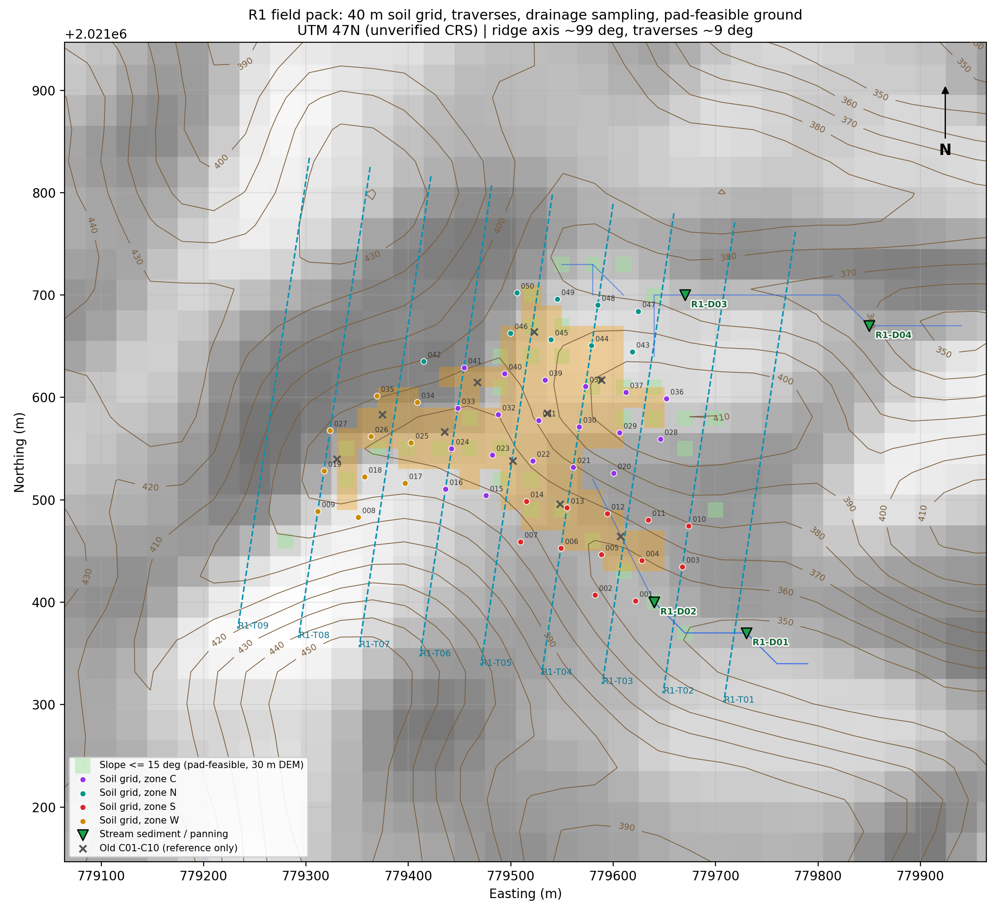

# R1 Drill-Site Selection Plan (on-site)

**Site:** Site 02, Sangthong, Laos. R1 / R01 patch, 3.92 ha, centre 779,540 E / 2,021,620 N
**Grid:** WGS 84 / UTM 47N (EPSG:32647). This is assumed and must be verified with GNSS on Day 0.
**Purpose:** narrow R1 down to 1–3 first drill collars, chosen from evidence collected on site.
**Field pack:** `outputs/r1_field/`. Load `r1_field_pack.gpx` on GPS units and phones, and `r1_field_pack.kml` in Google Earth.
**Status:** working plan, 12 Oct 2026. The thresholds in §5 are starting points for the project geologist to confirm.

---

## 1. How collars get chosen

The team is in R1. The question is no longer whether to work here. It is **where inside R1 to put the first holes.** The satellite work cannot answer that:
- EMIT pixels are about 60 m across, so all of R1 is roughly 15 pixels.
- The kaolinite + iron-oxide signal at R1 also appears on most bare ground within 20 km (see [R1_MULTIDATE_REANALYSIS.md](R1_MULTIDATE_REANALYSIS.md)).

So the satellite data says where to **start looking**, and the field evidence below decides where to **drill**.

**Rule:** every proposed collar must have its evidence written down against the criteria in §5. The old points C01–C10 are in the GPS file as `old-C01` to `old-C10`, for reference only. They are not collar positions, and neither are the old azimuths (225° / 240° / 210°), which were not based on any measured structure.

---

## 2. What we know before stepping out (evidence summary)

| Topic | What the data says | Confidence | Source |
|---|---|---|---|
| Terrain | R1 is an **east-facing spur**, 354–412 m elevation. Higher ground is W/SW (420–450 m). Runoff drains **E and SE** into two gullies (D01/D02 south-east, D03/D04 north-east). | Medium (30 m DEM includes canopy height) | `r1_field_map.png`, `07_Elevation.tif` |
| Surface | Bare soil peaked in early 2025 (54–65% of R1) and fell to ~0% by Apr 2026. It is revegetating. Likely recent clearing or earthworks. | Medium | EMIT FRCOV, [R1_MULTIDATE_REANALYSIS.md §4](R1_MULTIDATE_REANALYSIS.md) |
| Minerals (satellite) | Kaolinite + muscovite + goethite/jarosite, repeatable over 2 dry seasons. The same assemblage appears on bare ground across the district, so it is consistent with lateritic weathering. Hydrothermal origin is not tested. | Medium for presence, low for meaning | [R1_MULTIDATE_REANALYSIS.md §3](R1_MULTIDATE_REANALYSIS.md) |
| Dickite / halloysite | One pixel each on one date, never repeated. | Do not use | same |
| Where the EMIT signal is most persistent | A band through the centre and south of R1: grid points **G013, G014, G022, G023, G030, G032** have Fe-oxide and kaolin on 4 of 4 dates. | Low (60 m pixels; 2 of the 4 dates are hazy or cloud edge) | `r1_soil_grid_40m.csv` |
| Rock type, structure, gold | **Unknown.** No geological map, structural data, geochemistry or assays exist for R1. | — | Site 02 package, [HYPERSPECTRAL_GOLD_RESEARCH.md](HYPERSPECTRAL_GOLD_RESEARCH.md) |
| How to read hyperspectral results | Gold is not detectable from orbit. Kaolinite, goethite and halloysite form by weathering as well as alteration. EMIT L2B mineral maps are not validated for exploration. | High | [HYPERSPECTRAL_GOLD_RESEARCH.md §2–3, §7](HYPERSPECTRAL_GOLD_RESEARCH.md) |

---

## 3. Field pack contents



| File | Contents | Use |
|---|---|---|
| `r1_field_pack.gpx` | 50 soil-grid waypoints (`R1-G001`…`G050`), 4 drainage waypoints (`R1-D01`…`D04`), 9 traverse tracks (`R1-T01`…`T09`), old C points | GPS / phone (OsmAnd, Gaia, Avenza, Garmin) |
| `r1_field_pack.kml` | Same, plus R1 20 m cells | Google Earth, QGIS |
| `r1_soil_grid_40m.csv` | Grid with E/N, lat/lon, elevation, slope, zone and EMIT persistence counts | Sample register |
| `r1_drainage_points.csv` | Stream-sediment and panning points traced downslope from R1 on the DEM | Drainage sampling |
| `r1_traverses.csv` | Traverse start and end points | Mapping |
| `r1_pad_feasible_cells.csv` | 37 cells (30 m) with slope ≤ 15° within 80 m of R1 | Pad logistics only |
| `r1_field_map.png` | Map of all of the above on hillshade and contours | Print / tablet |
| `r1_collar_calc.py` | Turns a measured structure into collar position, azimuth and hole length (§6) | Hole design |

**Layout:**
- Soil grid: 40 m spacing, aligned with R1's long axis (~99°), extended 40 m outside R1. 29 of the 50 points are inside R1.
- Traverses: 60 m apart, running ~9° (roughly N–S) across R1.
- Re-orienting traverses: if the main rock or vein strike turns out to be different, rotate the traverses to run perpendicular to it. Do this after Day 1.

To regenerate the pack, run `~/miniconda3/envs/geo/bin/python make_r1_field_pack.py`.

---

## 4. Work sequence

Plan on about 5–6 field days, followed by 1–3 weeks of lab turnaround. Steps marked ⏱ produce answers on site; the others wait for the lab.

### Day 0: safety, access and location (do not skip)
- **UXO.** Get UXO clearance or a check from the responsible local authority **before any digging**, pitting or trenching. The Site 02 field guide requires this.
- **Permits.** Confirm access rights, landowner permission and the exploration licence status for drilling.
- **GNSS check.** Occupy a known control point, or compare a handheld GNSS fix with a clear landmark on imagery. This confirms the UTM 47N assumption. If positions are off, **stop and re-project the pack** before using any coordinates.
- **⏱ Why is R1 bare?** Photograph R1 from at least 4 directions and ask local people:
  - When was it cleared, by whom, and why (farming, road, quarry)?
  - Are there **old pits, shafts, adits or panning sites** nearby? Local artisanal workings are the strongest gold indicator likely to be available on site. Record each one with GPS and photos.

### Days 1–2: geological mapping (traverses T01–T09)
Walk each traverse. Leave it wherever there is outcrop, float or workings to the side. Record:
- **Rock type** of every outcrop and of float. Note whether float is angular, since angular float is close to its source.
- **Alteration:** bleaching, clay, silicification, and iron-oxide style. Look for goethite (brown/yellow-brown), jarosite (mustard yellow) and hematite (red). **Boxwork** (cavities left by dissolved sulphides) is significant.
- **Quartz veins:**
  - texture: banded, colloform, crustiform, bladed, comb or vuggy (epithermal style) versus massive milky (orogenic style)
  - width
  - sulphide or boxwork content
- **Structure:** take strike, dip and dip direction of every vein, fault, shear and foliation with a compass-clinometer. Aim for 20+ readings in total. These measurements set the hole orientation.
- **Float trains:** follow quartz or gossan float **upslope** to its source.

### Days 1–3: Phase A sampling

**Soil grid, G001–G050:**
- Dig 40–60 cm. Sample the **same horizon** everywhere, normally lower B or upper C/saprolite, and avoid organic topsoil.
- Take 300–500 g sieved to −2 mm (or bag whole for lab sieving).
- Record depth, horizon, colour and any fragments.
- **Sampling order:**
  1. The persistent-EMIT band: G013, G014, G022, G023, G030, G032.
  2. The rest of zones C and S.
  3. Zones N and W.
- Complete the full grid. The order only matters if time runs short.

**Rock chips:** take 1–3 kg from every vein, gossan or altered outcrop, as a channel across the vein where possible. Label each with its waypoint.

**Drainage, D01–D04:**
- D01/D02 drain the south and south-east of R1. D03/D04 drain the north-east.
- At each point take a −80 mesh (−180 µm) stream-sediment sample, or a bulk sample for BLEG if the lab offers it.
- **⏱ Pan** a standard volume (e.g., 10 L) and count gold grains. Note grain shape: angular or delicate grains have travelled only a short distance.
- Walk 100–200 m further downstream and add a sample at each confluence.

**QA/QC:** 1 field duplicate and 1 blank per 20 samples. The lab inserts certified reference materials (CRMs).

**⏱ On-site screening, if instruments are available:**
- **pXRF** on soils and rocks for pathfinders: As, Sb, Cu, Pb, Zn, Mo, Bi, W, plus Fe and K. pXRF **cannot** measure Au at soil levels.
- **Handheld SWIR** (TerraSpec, ASD or Spectral Evolution) on clays and altered rock, to tell weathering from alteration:
  - kaolinite crystallinity
  - **dickite, alunite, pyrophyllite** (these minerals form hot and point to hydrothermal alteration)
  - the white-mica 2200 nm absorption position
- If neither instrument is on site, send splits to the lab for XRD.

### Days 3–5: follow-up on anything anomalous
An anomaly is any of:
- a vein with sulphide or boxwork
- gold grains in a pan
- a cluster of high pXRF As/Sb readings
- SWIR hydrothermal minerals

For each anomaly:
1. **Infill at 20 m** around it, and extend the grid 40–80 m along strike if the anomaly reaches the edge of R1.
2. **⏱ Pits or trenches** (after UXO clearance): hand-dug, 1–2 m deep, perpendicular to the measured strike and about 20–40 m long. Map the walls and channel-sample at 1 m intervals. Getting from soil down to saprolite or bedrock is the aim.
3. **Re-measure structure** in the trench walls. Trench readings are more reliable than outcrop readings.

### Lab (1–3 weeks; confirm with the lab)
- **Au:** fire assay, 30–50 g charge, AAS or ICP finish. Use screen fire assay where visible gold or coarse grains are found.
- **Multi-element:** 4-acid digest with ICP-MS.
- **Clays:** XRD on selected samples.

---

## 5. Decision framework: go / conditional / no-go per zone

Score **zones** (a cluster of grid points, trenches and outcrops), not single points.

| # | Criterion | Evidence that counts | Weight |
|---|---|---|---|
| A | **In-situ mineralised structure** | Vein, fault or shear zone seen in outcrop or trench, with measured strike and dip | **Required** |
| B | **Au in rock** | Rock-chip or channel Au: ≥ 0.1 g/t supportive, **≥ 0.5 g/t strong** | High |
| C | **Au in soil** | ≥ 2–3 **adjacent** grid points above the local threshold (e.g., the 90–95th percentile of the R1 grid, or > 2× median), preferably elongate along the measured structure | High |
| D | **Pathfinders** | As, Sb (± Bi, Te, Mo, Cu) elevated at the same points as the Au anomaly | Medium |
| E | **Hydrothermal alteration confirmed** | SWIR or XRD shows dickite, alunite, pyrophyllite, sericite zoning or silicification, not only kaolinite + goethite | Medium |
| F | **Drainage link** | Gold grains or sediment Au in D01–D04 whose catchment contains the zone | Supporting |
| G | **Pad and access** | Collar pad about 10 × 15 m on slope ≤ 15° (or levelled), water source, rig access, UXO-cleared, landowner permission | **Required** |

**Decision rules** (the project geologist can adjust them, but should record any change):
- **GO:** A + G, plus (B strong, or C with D), plus at least one of E or F.
- **CONDITIONAL:** A + G with only B supportive or C alone. Run more trenching or a short scout hole (RC or a shallow core hole) before committing to the full program.
- **NO-GO for drilling:** no in-situ structure, or no gold signal in rock, soil or drainage. Extend the soil grid, test another review patch (R02–R10), or move to stream-sediment work across the wider Site 02 area.

Calibrate the soil-Au threshold on R1's own grid results, because background varies a lot in lateritic soils. Do not borrow a number from another district.

---

## 6. Designing a hole once a zone passes

1. **Measure first, then design.** Use the dominant strike, dip and dip direction of the mineralised structure from trenches and outcrop.
2. **Drill from the hanging-wall side.** Hole azimuth = dip direction + 180°, and hole dip −50° to −60°. Aim for the hole to cut the structure at **≥ 45°**.
3. **First intersection depth:** about 40–60 m vertically below the surface anomaly. That should test below the oxidised zone while staying shallow. Plan to drill about 30 m past the structure.
4. **Use diamond core (HQ, then NQ)** for the first holes, oriented if possible, so the structure and alteration can be measured in the core. RC drilling is cheaper but gives no structural data.
5. **Second hole:** 40–50 m along strike on the same structure, or a deeper hole on the same section if the first one hits.
6. **Check the pad on the ground.** The pad-feasible cells come from a 30 m DEM that includes tree height.

**Collar calculator.** Run it from the project folder:
```bash
~/miniconda3/envs/geo/bin/python r1_collar_calc.py --e <E> --n <N> --dipdir <deg> --dip <deg> --depth 50 --hole-dip 55
```

Worked example. Suppose a vein crops out at E 779540 / N 2021560 and dips 65° toward 120°:
```
COLLAR                   E 779586.3  N 2021533.3  elev 378.3 m   (lat 18.265052, lon 101.644249)
hole azimuth / dip       300 deg / -55 deg
length to intersection   53 m   planned total depth 83 m
hole cuts structure at   60 deg
ground slope at collar   30.8 deg -> WARNING: check pad access or move along strike
```
These numbers are hypothetical, to show how the tool works. If the structure is vertical, a −55° hole cuts it at only 35°. The tool warns about this, and the fix is to flatten the hole to about −45° or move the collar.

---

## 7. Prior zones inside R1 (where to look first, not where to drill)

| Zone | Grid pts (in R1) | Mean elev / slope | EMIT Fe / kaolin persistence (of 4 dates) | Notes | Sampling priority |
|---|---|---|---|---|---|
| **C**: central spur | 19 (15) | 384 m / 18° | 2.3 / 3.2 | Highest persistence (G022, G023, G030, G032 at 4/4). Most pad-feasible cells (15). | 1 |
| **S**: south slope | 12 (6) | 363 m / 20° | 1.6 / 3.1 | G013/G014 at 4/4. Foot of slope, so the Fe-oxide could be **transported** material rather than gossan; check whether it sits on bedrock. Drains to D01/D02. | 1 |
| **W**: western margin | 10 (4) | 375 m / 19° | 1.4 / 2.7 | Flatter cells G024–G026 (6–7°) are good for a pad | 2 |
| **N**: summit flat | 9 (4) | 389 m / 17° | 0.1 / 1.2 | Weakest satellite signal. Was the old "dickite" C03 area, which is not supported. | 3 |

The persistence counts are 60 m pixel values assigned to 40 m grid points, so neighbouring points share pixels. **A zone's priority changes as soon as field evidence comes in.**

---

## 8. Daily recording and reporting

- Use `05_Field_Forms/field_records_template.csv` with the same `sample_id` = waypoint ID (e.g., `R1-G022-S` for soil, `R1-G022-R1` for the first rock chip).
- Add these columns: `horizon`, `depth_cm`, `structure_type`, `strike`, `dip`, `dip_direction`, `vein_texture`, `pxrf_As`, `pxrf_Sb`, `swir_mineral`, `pan_grain_count`.
- Photos: file name = sample ID + direction (e.g., `R1-G022_N.jpg`).
- End-of-day report (one paragraph plus a map screenshot):
  - points completed
  - veins and structures measured
  - ⏱ anomalies (pan, pXRF, SWIR)
  - tomorrow's infill or trench plan
- Keep observations ("yellow-brown earthy coating") separate from interpretations ("jarosite"), as the Site 02 field guide asks.

---

## 9. Risks and caveats

- **Unconfirmed coordinates.** The coordinate system is still an assumption until the Day 0 check.
- **R1 may be human-made exposure.** If it is a recent clearing, what was exposed is soil, not outcrop. The geology then has to come from pits, trenches and float.
- **Transported cover.** Colluvium on the S slope and the gullies can move signals downhill. Trace anomalies upslope.
- **Deep weathering.** Tropical oxidation can reach tens of metres, and surface gold can be depleted or enriched relative to depth.
- **Nugget effect.** Coarse gold gives erratic assays. Use duplicates and screen fire assay where grains are seen.
- **DEM limits.** Slopes and drainage come from a 30 m DEM that includes canopy, so verify them on the ground.

---

## 10. Backup and evidence index

| File | What it supports |
|---|---|
| [R1_MULTIDATE_REANALYSIS.md](R1_MULTIDATE_REANALYSIS.md) | Date quality, minerals across 8 EMIT dates, bare-ground control, cover trend, why the old C-points don't hold up |
| `outputs/r1_multidate/*.csv` | Tables behind the re-analysis |
| [HYPERSPECTRAL_GOLD_RESEARCH.md](HYPERSPECTRAL_GOLD_RESEARCH.md) | Literature: what hyperspectral can and cannot show for gold, alteration models, the evidence steps from satellite to drilling |
| [analyze_r1_multidate.py](analyze_r1_multidate.py) | Reproduces the re-analysis |
| [make_r1_field_pack.py](make_r1_field_pack.py) | Reproduces the field pack (grid, traverses, drainage, pads, map) |
| [r1_collar_calc.py](r1_collar_calc.py) | Collar geometry |
| `drive-download-20261011T175941Z-1-001/` | Original Site 02 package: AOI, DEM, slope, R01–R10 review areas, field guide and record template |
| [R1_CANDIDATE_EXPLORATION_PLAN.md](R1_CANDIDATE_EXPLORATION_PLAN.md) | Superseded single-date plan. Keep its §5 field-validation steps; its drill holes are replaced by §5–6 here |

---

## Appendix A: soil-grid waypoints (UTM 47N / WGS 84)

EMIT counts are out of 4 dates (2025-01-22, 2026-01-21, 2026-01-25, 2026-04-16) and are indicative only.

| ID | Zone | In R1 | Easting | Northing | Lat | Lon | Elev m | Slope ° | EMIT Fe | EMIT kaol |
|---|---|---|---|---|---|---|---|---|---|---|
| R1-G001 | S | – | 779621.9 | 2021401.3 | 18.263855 | 101.644568 | 353.2 | 17.4 | 1 | 4 |
| R1-G002 | S | – | 779582.4 | 2021407.3 | 18.263915 | 101.644195 | 363.1 | 24.6 | 0 | 3 |
| R1-G003 | S | – | 779667.5 | 2021434.8 | 18.264152 | 101.645003 | 362.0 | 27.1 | 1 | 2 |
| R1-G004 | S | ✓ | 779627.9 | 2021440.8 | 18.264212 | 101.644630 | 353.9 | 20.3 | 1 | 3 |
| R1-G005 | S | ✓ | 779588.4 | 2021446.8 | 18.264271 | 101.644258 | 353.7 | 8.8 | 2 | 4 |
| R1-G006 | S | ✓ | 779548.8 | 2021452.9 | 18.264331 | 101.643885 | 359.5 | 17.7 | 3 | 4 |
| R1-G007 | S | – | 779509.3 | 2021458.9 | 18.264390 | 101.643512 | 371.6 | 26.6 | 0 | 2 |
| R1-G008 | W | – | 779351.1 | 2021482.9 | 18.264628 | 101.642020 | 380.4 | 24.5 | 1 | 2 |
| R1-G009 | W | – | 779311.6 | 2021488.9 | 18.264687 | 101.641647 | 377.3 | 16.2 | 1 | 3 |
| R1-G010 | S | – | 779673.5 | 2021474.4 | 18.264508 | 101.645066 | 376.4 | 22.8 | 0 | 2 |
| R1-G011 | S | – | 779634.0 | 2021480.4 | 18.264568 | 101.644693 | 379.5 | 26.8 | 1 | 2 |
| R1-G012 | S | ✓ | 779594.4 | 2021486.4 | 18.264627 | 101.644320 | 363.6 | 24.5 | 2 | 3 |
| **R1-G013** | S | ✓ | 779554.9 | 2021492.4 | 18.264687 | 101.643947 | 359.6 | 9.5 | 4 | 4 |
| **R1-G014** | S | ✓ | 779515.3 | 2021498.4 | 18.264746 | 101.643574 | 364.5 | 14.7 | 4 | 4 |
| R1-G015 | C | – | 779475.8 | 2021504.4 | 18.264806 | 101.643201 | 373.2 | 24.0 | 2 | 4 |
| R1-G016 | C | – | 779436.2 | 2021510.4 | 18.264865 | 101.642828 | 372.5 | 24.6 | 3 | 3 |
| R1-G017 | W | – | 779396.7 | 2021516.5 | 18.264925 | 101.642455 | 374.6 | 24.4 | 2 | 3 |
| R1-G018 | W | – | 779357.1 | 2021522.5 | 18.264984 | 101.642082 | 371.4 | 19.8 | 3 | 4 |
| R1-G019 | W | – | 779317.6 | 2021528.5 | 18.265044 | 101.641710 | 372.6 | 16.6 | 1 | 3 |
| R1-G020 | C | – | 779600.4 | 2021525.9 | 18.264984 | 101.644382 | 386.5 | 29.9 | 2 | 3 |
| R1-G021 | C | ✓ | 779560.9 | 2021531.9 | 18.265043 | 101.644009 | 369.4 | 26.2 | 3 | 3 |
| **R1-G022** | C | ✓ | 779521.3 | 2021538.0 | 18.265103 | 101.643636 | 372.1 | 25.0 | 4 | 4 |
| **R1-G023** | C | ✓ | 779481.8 | 2021544.0 | 18.265162 | 101.643263 | 362.5 | 11.3 | 4 | 4 |
| R1-G024 | C | ✓ | 779442.2 | 2021550.0 | 18.265221 | 101.642890 | 361.1 | 5.8 | 2 | 3 |
| R1-G025 | W | ✓ | 779402.7 | 2021556.0 | 18.265281 | 101.642518 | 362.4 | 7.4 | 2 | 4 |
| R1-G026 | W | ✓ | 779363.2 | 2021562.0 | 18.265340 | 101.642145 | 364.8 | 5.9 | 3 | 3 |
| R1-G027 | W | – | 779323.6 | 2021568.0 | 18.265400 | 101.641772 | 383.2 | 23.3 | 0 | 1 |
| R1-G028 | C | – | 779646.0 | 2021559.5 | 18.265280 | 101.644817 | 406.3 | 17.9 | 0 | 1 |
| R1-G029 | C | ✓ | 779606.4 | 2021565.5 | 18.265340 | 101.644444 | 410.5 | 8.4 | 3 | 3 |
| **R1-G030** | C | ✓ | 779566.9 | 2021571.5 | 18.265399 | 101.644071 | 405.6 | 15.3 | 4 | 4 |
| R1-G031 | C | ✓ | 779527.3 | 2021577.5 | 18.265459 | 101.643698 | 380.0 | 27.4 | 3 | 4 |
| **R1-G032** | C | ✓ | 779487.8 | 2021583.5 | 18.265518 | 101.643326 | 366.9 | 15.8 | 4 | 4 |
| R1-G033 | C | ✓ | 779448.3 | 2021589.5 | 18.265578 | 101.642953 | 365.4 | 11.0 | 2 | 3 |
| R1-G034 | W | ✓ | 779408.7 | 2021595.5 | 18.265637 | 101.642580 | 381.4 | 26.5 | 1 | 2 |
| R1-G035 | W | ✓ | 779369.2 | 2021601.6 | 18.265697 | 101.642207 | 383.9 | 23.2 | 0 | 2 |
| R1-G036 | C | ✓ | 779652.0 | 2021599.0 | 18.265637 | 101.644879 | 409.8 | 11.4 | 1 | 1 |
| R1-G037 | C | ✓ | 779612.4 | 2021605.0 | 18.265696 | 101.644507 | 408.4 | 10.8 | 2 | 4 |
| R1-G038 | C | ✓ | 779572.9 | 2021611.0 | 18.265756 | 101.644134 | 403.5 | 14.5 | 1 | 4 |
| R1-G039 | C | ✓ | 779533.4 | 2021617.0 | 18.265815 | 101.643761 | 381.8 | 21.9 | 2 | 3 |
| R1-G040 | C | ✓ | 779493.8 | 2021623.1 | 18.265875 | 101.643388 | 371.1 | 13.2 | 2 | 3 |
| R1-G041 | C | ✓ | 779454.3 | 2021629.1 | 18.265934 | 101.643015 | 384.2 | 25.7 | 0 | 2 |
| R1-G042 | N | – | 779414.7 | 2021635.1 | 18.265993 | 101.642642 | 397.2 | 22.8 | 0 | 0 |
| R1-G043 | N | – | 779618.5 | 2021644.6 | 18.266052 | 101.644569 | 400.9 | 20.1 | 0 | 1 |
| R1-G044 | N | ✓ | 779578.9 | 2021650.6 | 18.266112 | 101.644196 | 397.9 | 16.7 | 1 | 4 |
| R1-G045 | N | ✓ | 779539.4 | 2021656.6 | 18.266171 | 101.643823 | 388.8 | 11.2 | 0 | 3 |
| R1-G046 | N | ✓ | 779499.8 | 2021662.6 | 18.266231 | 101.643450 | 383.9 | 15.1 | 0 | 1 |
| R1-G047 | N | – | 779624.5 | 2021684.1 | 18.266409 | 101.644631 | 386.6 | 24.8 | 0 | 0 |
| R1-G048 | N | – | 779584.9 | 2021690.1 | 18.266468 | 101.644258 | 377.1 | 18.5 | 0 | 1 |
| R1-G049 | N | – | 779545.4 | 2021696.1 | 18.266528 | 101.643885 | 381.4 | 16.4 | 0 | 1 |
| R1-G050 | N | ✓ | 779505.8 | 2021702.2 | 18.266587 | 101.643512 | 383.6 | 7.9 | 0 | 0 |

## Appendix B: drainage / panning waypoints

| ID | Distance below R1 | Upstream cells (30 m) | Easting | Northing | Lat | Lon | Elev m |
|---|---|---|---|---|---|---|---|
| R1-D01 | ~80 m (SE gully, main) | 100 | 779730.0 | 2021370.0 | 18.263559 | 101.645585 | 342.1 |
| R1-D02 | ~80 m (S gully) | 60 | 779640.0 | 2021400.0 | 18.263841 | 101.644739 | 347.9 |
| R1-D03 | ~80 m (NE gully) | 13 | 779670.0 | 2021700.0 | 18.266546 | 101.645063 | 368.1 |
| R1-D04 | ~250 m (NE gully) | 47 | 779850.0 | 2021670.0 | 18.266252 | 101.646760 | 351.8 |

The drainage lines are traced on a 30 m DEM. Walk the actual creek from each point and add samples at confluences 100–200 m further downstream.
